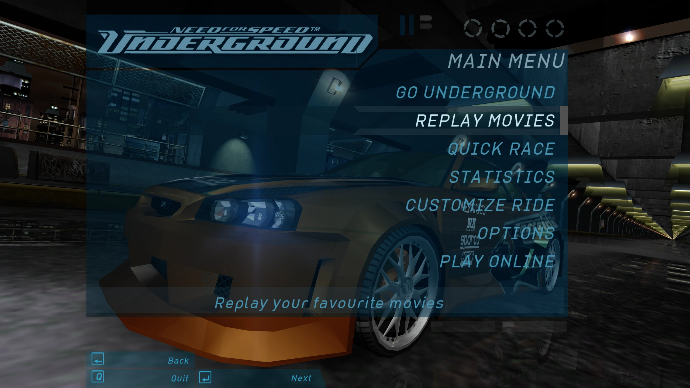
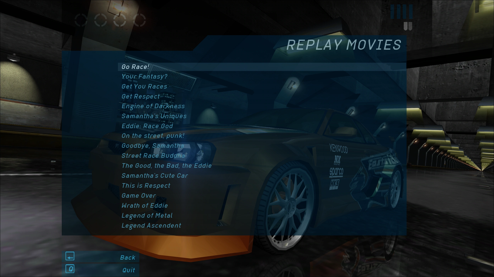
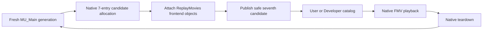

# ReplayMovies

**Native cinematic replay · Feature complete / maintenance only**

ReplayMovies integrates **REPLAY MOVIES** as a seventh selectable option in the existing Need for Speed: Underground (2003) PC Main Menu. It brings a profile-aware catalog of **17 career cinematics** into the game's own frontend and movie playback lifecycle—without an external launcher or video player.

> [!NOTE]
> This branch documents a completed implementation. Its historic bug investigations should not be mistaken for open feature work. Private C++ sources and compiled `.asi` releases are not hosted here.

## In-game interface

These captures show the finished native-style entry point and the career-film browser. The submenu image illustrates the visible catalog, not every User-mode progression state.

| Main Menu · seventh option | ReplayMovies · career-film submenu |
| :---: | :---: |
|  |  |

See [Frontend integration](docs/FRONTEND_INTEGRATION.md) for native ownership, selection and return behavior. The visual captures complement—but do not replace—the runtime validation record.

## Features

| Area | Completed behavior |
| :--- | :--- |
| Main Menu | Native seventh candidate with existing six options preserved; integrated highlight, selector and navigation. |
| Movie browser | Native-style submenu with canonical 17-film career catalog; automatic intro films are excluded. |
| **User** catalog | Compact list of movies encountered by the active profile, persisted in a profile-specific seen mask. |
| **Developer** catalog | All 17 canonical titles available for inspection without manufacturing progression. |
| Playback | Dispatches the selected film through Underground's own FMV path, then returns to the frontend. |
| Edge cases | Empty and one-row catalogs, native Trailers/NASCAR isolation, Back navigation and repeated menu reconstruction. |

## Lifecycle in one view

**Ownership is the governing invariant:** candidate memory remains native-owned; cloned frontend objects belong to the current menu generation. The final fix for an intermittent missing entry resolves selected/unselected presentation descriptors through semantic ownership, **not** a presumed fixed heap offset.

## Final engineering evidence

- **15/15** fresh `MU_Main` reconstructions passed the specific descriptor-ownership regression test.
- ReplayMovies remained present across recorded post-movie and alternate Race → Quit Game menu reconstruction paths.
- Career encounters committed profile unlocks on **natural movie completion or skip**; ReplayMovies-originated viewings did not create new unlocks.
- Fresh profiles, one-row catalogs and native Trailers/NASCAR isolation were explicitly verified.

Read [Validation](docs/VALIDATION.md) for test scope and [Engineering history](docs/ENGINEERING_HISTORY.md) for superseded approaches.

## Documentation index

| Start here | Deep dive |
| :--- | :--- |
| [Architecture](docs/ARCHITECTURE.md) | Ownership, native seven-candidate reconstruction, catalog separation. |
| [Frontend integration](docs/FRONTEND_INTEGRATION.md) | Selection, visual identity, catalog presentation and Back. |
| [Movie catalog](docs/MOVIE_CATALOG.md) | Canonical career movie IDs, displayed titles and ordering. |
| [Profile progression](docs/PROFILE_PROGRESSION.md) | User / Developer behavior and persisted `SeenMask`. |
| [Lifecycle and hooks](docs/LIFECYCLE_AND_HOOKS.md) | Generation observers, native FMV activation and return. |
| [Validation](docs/VALIDATION.md) | Regression evidence, pass conditions and limits. |
| [Engineering history](docs/ENGINEERING_HISTORY.md) | Key discoveries and superseded hypotheses. |
| [Build notes](docs/BUILDING.md) | Historical build evidence and unpublished-source policy. |

## Compatibility and availability

The reverse-engineered baseline is **English PC v1.4 x86**. ReplayMovies source, build projects, INI samples and binaries are currently private. **Nexus Mods** is the intended channel for compiled releases; no download link is claimed until a public page exists.

[← Project hub](https://github.com/Gxbbykko/Underground_ReplayMovies_FMVPatch/tree/main) · [FMVFix](https://github.com/Gxbbykko/Underground_ReplayMovies_FMVPatch/tree/FMVFix) · [FMVPatch](https://github.com/Gxbbykko/Underground_ReplayMovies_FMVPatch/tree/FMVPatch)
