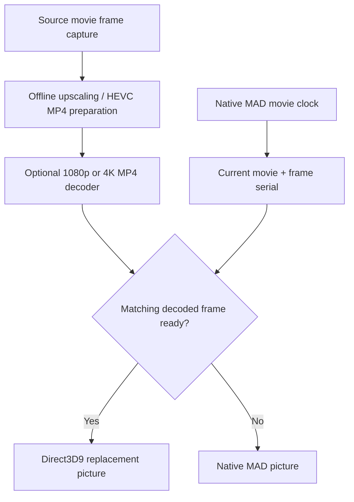

# FMVPatch

**High-resolution cinematic presentation · Integrated with FMVFix**

FMVPatch documents **offline AI-upscaled** 1080p and 4K HEVC MP4 playback in Need for Speed: Underground (2003). Its runtime work is implemented inside FMVFix; there is **no third standalone FMVPatch `.asi`** and **no real-time AI upscaling**.

> [!NOTE]
> The native Xbox/PC `.mad` path continues to own movie timing, audio, frame serials, skipping and teardown. MP4 is an **optional picture source**. Native MAD picture remains the safe fallback.

## Visual comparison — selected movie frames

The same movie IDs are illustrated in Xbox, 1080p and 4K playback modes. The Xbox reference screenshots are stored on the [FMVFix branch](https://github.com/Gxbbykko/Underground_ReplayMovies_FMVPatch/tree/FMVFix); the high-resolution mode captures are included here.

**`E3_TITLE` — engine detail**

| Xbox mode | 1080p mode | 4K mode |
| :---: | :---: | :---: |
|  |  |  |

**`01_DAY` — wheel detail**

| Xbox mode | 1080p mode | 4K mode |
| :---: | :---: | :---: |
|  |  |  |

> [!NOTE]
> All screenshots are **2560 × 1440 desktop captures**. Mode names refer to the **video source tier**, not screenshot file dimensions. The selected stills are not guaranteed to represent identical native frame serials or identical display scaling. Visual comparison is illustrative; exact frame-matching results come from the runtime reports.

See the [five-scene gallery and mode definitions](docs/VIDEO_MODES.md) for the rest.

## Pipeline overview

## Consolidated Stage 2.5.3 report

| Metric | 1080p | 4K |
| :--- | ---: | ---: |
| Movies represented | **20** | **15** |
| Native movie serials | **9,931** | **5,610** |
| Exact MP4 substitutions | **9,922** | **5,583** |
| Initial serials falling back | **9** | **27** |
| Decoder failures | **0** | **0** |
| Texture upload/binding failures | **0** | **0** |

The 4K results describe **15 movies**, not a full 20-movie 4K test. Nine out-of-predicted-order ReplayMovies selections used native MAD for their first serial (1080p) or first three serials (4K), then caught up. Read [Validation](docs/VALIDATION.md) and [Known limitations](docs/KNOWN_LIMITATIONS.md) for the complete interpretation.

## Technical documentation

| Playback stage | Page |
| :--- | :--- |
| Integration boundaries | [Architecture](docs/ARCHITECTURE.md) |
| Source preparation | [Upscaling pipeline](docs/UPSCALING_PIPELINE.md) |
| MP4 decode | [MP4 playback](docs/MP4_PLAYBACK.md) |
| Mode selection | [Video modes](docs/VIDEO_MODES.md) |
| Frame mapping | [Frame synchronization](docs/FRAME_SYNCHRONIZATION.md) |
| GPU presentation | [Renderer integration](docs/RENDERER_INTEGRATION.md) |
| Startup frames | [Prewarm optimization](docs/PREWARM_OPTIMIZATION.md) |
| Test data | [Validation](docs/VALIDATION.md) |
| Measured performance | [Performance](docs/PERFORMANCE.md) |
| Open limitations | [Known limitations](docs/KNOWN_LIMITATIONS.md) |
| Development record | [Engineering history](docs/ENGINEERING_HISTORY.md) |

## Distribution boundary

No MP4 files, extracted source frames, copyrighted cinematics, FMVFix implementation source, or compiled ASIs are contained in this repository. The documented environment is the **English PC v1.4 x86** game; other configurations require separate validation. Installable plugin releases are intended for **Nexus Mods**.

[← Project hub](https://github.com/Gxbbykko/Underground_ReplayMovies_FMVPatch/tree/main) · [FMVFix](https://github.com/Gxbbykko/Underground_ReplayMovies_FMVPatch/tree/FMVFix)
