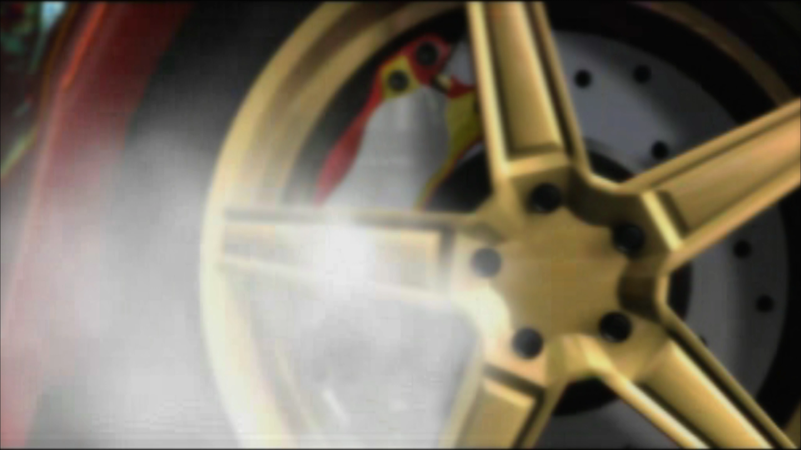

# FMVFix

**Xbox-to-PC movie compatibility · Completed native framework**

FMVFix adapts Xbox-origin `.mad` cinematics to the original **Need for Speed: Underground (2003) PC FMV subsystem**. The objective is native playback compatibility, preserving the game's movie identity, timing, audio, skip and teardown behavior rather than launching an external player.

> [!IMPORTANT]
> The optional high-resolution playback code documented in **[FMVPatch](https://github.com/Gxbbykko/Underground_ReplayMovies_FMVPatch/tree/FMVPatch)** is integrated into **FMVFix**. FMVPatch is a distinct documentation branch, **not a third separately built ASI**.

## Xbox-mode playback captures

The images below are user-provided captures labeled `XBOX` in the original archive. They illustrate native movie picture presentation in the documented Xbox compatibility mode. They are not raw `.mad` files or evidence of universal Xbox-asset compatibility.

| `E3_TITLE` · cinematic | `01_DAY` · career film | `PSA` · intro |
| :---: | :---: | :---: |
|  |  |  |

[View both `NA_BOOT` intro captures](docs/XBOX_VS_PC.md#xbox-mode-screenshot-gallery) · [Read the controlled comparison method](docs/XBOX_VS_PC.md).

## What FMVFix owns

| Layer | Responsibility |
| :--- | :--- |
| Native compatibility | Trace and accommodate Xbox-vs-PC `.mad` stream/parser and decoder-path differences. |
| Native lifecycle | Keep Underground's own movie start, playback timing, soundtrack, skipping, return and cleanup. |
| Optional picture substitution | Supply the FMVPatch path for matched 1080p/4K MP4 frames while preserving native fallback. |
| Failure behavior | Keep the native `.mad` picture when an optional MP4 replacement is missing, late or unready. |

## Runtime video modes

| `Mode` | Picture behavior |
| :--- | :--- |
| `Xbox` | Xbox `.mad` compatibility **without** optional MP4 substitution. |
| `1080p` | Use a prepared 1080p HEVC MP4 frame **only** when it matches the native frame serial. |
| `4K` | Use a prepared 4K HEVC MP4 frame **only** when it matches the native frame serial. |

The original `.mad` still controls the movie lifecycle in all three modes. Tier files and the private runtime INI are **not** published here.

## Evidence and qualification

The Xbox-to-PC compatibility layer was documented and subsequently kept source-identical across **six frozen compatibility functions** during optional MP4 work. The final integrated Stage 2.5.3 report covers **20 movies at 1080p** and **15 reported movies at 4K**, with no decoder or texture upload/binding failures in those sessions. These figures validate the picture-substitution layer in its reported sessions—not universal Xbox parser compatibility on arbitrary executables.

A later production-oriented source snapshot disabled routine diagnostic reports and retained errors for genuine decoder, file, hook or texture failures. An archived Windows build exists in the project handoff, but **no new gameplay run** was performed solely to prepare these public pages. See [Validation](docs/VALIDATION.md) for the distinction.

## Documentation index

| Topic | Page |
| :--- | :--- |
| System overview | [Architecture](docs/ARCHITECTURE.md) |
| Platform comparison | [Xbox vs PC](docs/XBOX_VS_PC.md) |
| Format observations | [MAD format](docs/MAD_FORMAT.md) |
| Parser and decoder | [Parser and decoder](docs/PARSER_AND_DECODER.md) |
| Compatibility corrections | [Compatibility fixes](docs/COMPATIBILITY_FIXES.md) |
| Movie start/return | [Native lifecycle](docs/NATIVE_LIFECYCLE.md) |
| Verification | [Validation](docs/VALIDATION.md) |
| Investigation timeline | [Engineering history](docs/ENGINEERING_HISTORY.md) |
| Build provenance | [Build notes](docs/BUILDING.md) |

## Availability

Documented target: **English PC v1.4 32-bit (`x86`)**. C++ source and Visual Studio project files are published on this branch. Runtime INIs, compiled `.asi` modules, original movies and upscaled MP4 assets are not hosted here. User-ready plugin releases are reserved for **Nexus Mods**.

[← Project hub](https://github.com/Gxbbykko/Underground_ReplayMovies_FMVPatch/tree/main) · [FMVPatch documentation](https://github.com/Gxbbykko/Underground_ReplayMovies_FMVPatch/tree/FMVPatch)
