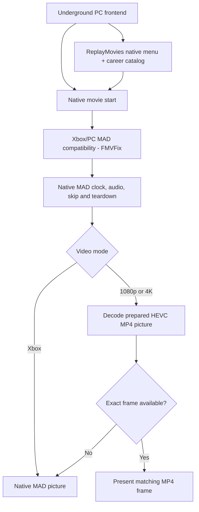

# Need for Speed: Underground (2003)

### ReplayMovies · FMVFix · FMVPatch

**Native cinematic replay, Xbox movie compatibility, and high-resolution FMV presentation for the English PC v1.4 (x86) release.**

[Explore ReplayMovies](https://github.com/Gxbbykko/Underground_ReplayMovies_FMVPatch/tree/ReplayMovies) · [Explore FMVFix](https://github.com/Gxbbykko/Underground_ReplayMovies_FMVPatch/tree/FMVFix) · [Explore FMVPatch](https://github.com/Gxbbykko/Underground_ReplayMovies_FMVPatch/tree/FMVPatch)

> [!IMPORTANT]
> This repository is a **documentation-first engineering archive**, not a download mirror. The official [Nexus Mods release page](https://www.nexusmods.com/needforspeedunderground/mods/33) is the central entry point for the ReplayMovies and FMVFix plugins and information about the optional movie packages. Original source and Visual Studio project files for the two plugins are on the `ReplayMovies` and `FMVFix` branches; compiled binaries and movie assets are not hosted here. Selected in-game screenshots document the interface and playback modes.

## Downloads — plugins and movie packages

**[Download ReplayMovies × FMVFix — Nexus Mods](https://www.nexusmods.com/needforspeedunderground/mods/33)**

Use the official Nexus Mods page for **plugin downloads, installation instructions, and links or information for optional movie packages**. The release centers on two compiled `.asi` plugins:

- **ReplayMovies** — the native in-game career-cinematic replay interface.
- **FMVFix** — Xbox-origin `.mad` compatibility with optional high-resolution FMV picture presentation. **FMVPatch functionality is integrated into FMVFix**; it is not a third `.asi` plugin.

### Movie presentation options

| Movie tier | Description |
| :--- | :--- |
| **Xbox Port** | Original Xbox-origin cinematics, displayed through the compatible native `.mad` movie pipeline. |
| **1080p — Offline AI Upscaled** | Prepared Full HD HEVC MP4 alternatives for compatible movie playback. |
| **4K — Offline AI Upscaled** | Prepared Ultra HD HEVC MP4 alternatives for compatible movie playback. |

**Where to find movie downloads:** Follow the instructions and movie-download links listed on the **[Nexus Mods page](https://www.nexusmods.com/needforspeedunderground/mods/33)**. This README intentionally does not include a direct external file-host link. Movie assets are **not distributed through GitHub**, and you should only obtain and use assets you are authorized to access.

## In-game screenshots

**ReplayMovies** adds the menu option and an in-game cinematic browser. These are captures of the running game—not conceptual mock-ups.

| Native Main Menu | ReplayMovies submenu |
| :---: | :---: |
|  |  |

**Cinematic presentation** — an illustrative capture of `E3_TITLE` in the three documented modes:

| Xbox mode | 1080p mode | 4K mode |
| :---: | :---: | :---: |
|  |  |  |

All images are user-provided **2560 × 1440 screen captures**. The Xbox/1080p/4K labels identify the selected **movie playback tier**, not the screenshot pixel dimensions. Stills are illustrative, not a controlled same-frame quality benchmark or proof of runtime frame-sync statistics. See the [ReplayMovies interface](https://github.com/Gxbbykko/Underground_ReplayMovies_FMVPatch/blob/ReplayMovies/docs/FRONTEND_INTEGRATION.md) and [FMVPatch mode comparison](https://github.com/Gxbbykko/Underground_ReplayMovies_FMVPatch/blob/FMVPatch/docs/VIDEO_MODES.md) for more images.

## At a glance

| Branch | Purpose | Engineering status | Documentation |
| :--- | :--- | :--- | :--- |
| **[ReplayMovies](https://github.com/Gxbbykko/Underground_ReplayMovies_FMVPatch/tree/ReplayMovies)** | Adds **REPLAY MOVIES** as a seventh native Main Menu option; provides a 17-film career catalog with per-profile unlocks. | **Feature complete · maintenance only** | [Architecture](https://github.com/Gxbbykko/Underground_ReplayMovies_FMVPatch/blob/ReplayMovies/docs/ARCHITECTURE.md) · [Validation](https://github.com/Gxbbykko/Underground_ReplayMovies_FMVPatch/blob/ReplayMovies/docs/VALIDATION.md) |
| **[FMVFix](https://github.com/Gxbbykko/Underground_ReplayMovies_FMVPatch/tree/FMVFix)** | Adapts Xbox-origin `.mad` cinematics to the native PC movie subsystem. | **Compatibility framework completed** | [Compatibility](https://github.com/Gxbbykko/Underground_ReplayMovies_FMVPatch/blob/FMVFix/docs/COMPATIBILITY_FIXES.md) · [Validation](https://github.com/Gxbbykko/Underground_ReplayMovies_FMVPatch/blob/FMVFix/docs/VALIDATION.md) |
| **[FMVPatch](https://github.com/Gxbbykko/Underground_ReplayMovies_FMVPatch/tree/FMVPatch)** | Documents optional playback of **offline AI-upscaled 1080p/4K HEVC MP4** picture through FMVFix. | **Runtime validated · known prewarm limitation** | [Pipeline](https://github.com/Gxbbykko/Underground_ReplayMovies_FMVPatch/blob/FMVPatch/docs/UPSCALING_PIPELINE.md) · [Validation](https://github.com/Gxbbykko/Underground_ReplayMovies_FMVPatch/blob/FMVPatch/docs/VALIDATION.md) |

`main` is the publication hub. The other three named branches are **permanent documentation areas, not branches to merge automatically**. There are **two primary ASI implementations**, not three: ReplayMovies and FMVFix. FMVPatch functionality belongs to the integrated FMVFix implementation.

## How the systems fit together

- **ReplayMovies** extends the game's own frontend. Its User view contains only career movies encountered by the active profile; its Developer view exposes the catalog without creating profile unlocks.
- **FMVFix** retains the native game's movie lifecycle while addressing platform-specific Xbox `.mad` handling.
- **FMVPatch** changes the displayed picture when a matching prepared MP4 frame is ready. It does **not** run AI upscaling during gameplay, change the native movie clock, replace the soundtrack, or disable native fallback.

## Evidence highlights

| Recorded measurement | Result | Scope |
| :--- | ---: | :--- |
| ReplayMovies fresh `MU_Main` reconstruction stress checks | **15 / 15 passed** | Closure of the semantic descriptor-ownership defect; not a general compatibility score. |
| ReplayMovies career-film catalog | **17 entries** | Excludes the three automatic introduction films. |
| 1080p exact MP4 picture matches | **9,922 / 9,931** | Stage 2.5.3 reports, **20 movies**. |
| 4K exact MP4 picture matches | **5,583 / 5,610** | Stage 2.5.3 reports, **15 movies**; not a 20-movie 4K pass. |
| Decoder / texture upload or binding failures | **0 / 0** | Within the two reported sets only. |

> [!NOTE]
> Nine out-of-predicted-order movie selections had initial-frame fallback: one native serial at 1080p or three at 4K, before MP4 decoding caught up. The source and reports do **not** support a claim of zero fallback for arbitrary movie selection. See [validation](https://github.com/Gxbbykko/Underground_ReplayMovies_FMVPatch/blob/FMVPatch/docs/VALIDATION.md) and [limitations](https://github.com/Gxbbykko/Underground_ReplayMovies_FMVPatch/blob/FMVPatch/docs/KNOWN_LIMITATIONS.md).

## Compatibility and distribution

| Item | Policy |
| :--- | :--- |
| Target executable | **Need for Speed: Underground (2003), English PC v1.4, 32-bit (`x86`)**. |
| Other game versions or localization | **Not automatically supported** without independent validation. |
| Source and project files | Published on the `ReplayMovies` and `FMVFix` branches; compiled plugin downloads are linked on [Nexus Mods](https://www.nexusmods.com/needforspeedunderground/mods/33). |
| Installable `.asi` modules | Download **ReplayMovies** and **FMVFix** through the [official Nexus Mods page](https://www.nexusmods.com/needforspeedunderground/mods/33), not GitHub. |
| Original `.mad` files, game executables and upscaled MP4s | **Never included** in this documentation repository. Movie-package information and any external download links are handled through [Nexus Mods](https://www.nexusmods.com/needforspeedunderground/mods/33). |
| Configuration examples | Under review; actual local INIs should not be uploaded as part of a documentation push. |

## Reading and contributing

The engineering history is chronological and contains many **superseded hypotheses**. Public pages distinguish measured runtime behavior, structural/source checks, and ideas that remain proposals. The current state follows the most recent validated checkpoint, not intermediate debugger failures.

Start from a branch README, follow its topical `docs/` index and consult its validation page for exactly what was tested. Documentation corrections are welcome under [Contributing](CONTRIBUTING.md); support boundaries are in [Support](SUPPORT.md), and disclosure rules are in [Security](SECURITY.md). See the [documentation changelog](CHANGELOG.md) for editorial milestones.

## Credits and rights

Project documentation and authored integration work: **Gxbbykko**. Investigation was informed by **Extra Options** (ExOpts Team) and the **Widescreen Fix** work associated with **ThirteenAG**. These remain distinct third-party projects; references here do not imply authorship, redistribution permission, or unconditional compatibility. The tested `NA_BOOT` picture-framing path is especially sensitive to the recorded Widescreen Fix cropped-mode geometry.

The user-provided in-game screenshots are illustrative captures, not redistributable standalone movie assets. The game, original FMVs, brands, and all other proprietary assets remain the property of their respective rights holders. See [LICENSE](LICENSE) for the repository's published license; it does not license those third-party assets.
