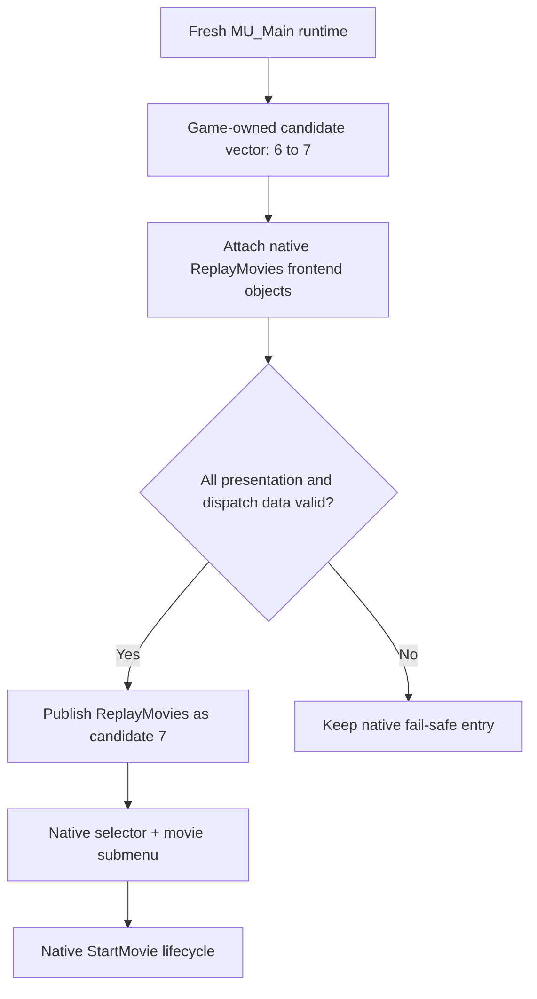

# Architecture

[← ReplayMovies overview](../README.md) · [Frontend integration](FRONTEND_INTEGRATION.md) · [Validation](VALIDATION.md)

## Design objective

ReplayMovies must feel like part of Underground's own frontend. It therefore uses the **native `MU_Main` candidate system**, rather than a painted overlay, external launcher or alternate FMV engine. The original Main Menu has six candidates; ReplayMovies adds a seventh while preserving their existing identities, ordering and behavior.

## Ownership and construction

The game must own the candidate allocation it later releases. An early attempt to publish plugin-static candidate memory into a game-owned runtime field violated that contract and led to a native destructor crash. The settled design uses **native-owned expanded storage**, constructs the new frontend entry inside the *current* menu generation, and publishes it only when construction is complete. The fallback position is kept safe until the feature is ready.

The option has distinct identities: an internal `ReplayMovies` name used by navigation/dispatch, and a visible uppercase **REPLAY MOVIES** caption consistent with the stock frontend. UI caption identity must never be mistaken for the internal dispatch identity.

## Generation isolation

A post-movie return, profile transition or race exit can reconstruct `MU_Main`. The allocator may reuse an old address for a new instance, so pointer equality **does not** guarantee object lifetime equality. Runtime pointers, native candidates, menu nodes and presentation properties are therefore reacquired at each qualified completed-generation event; no cross-generation cached frontend pointers are trusted.

## Semantic presentation ownership

A historical assumption treated selected and unselected geometry descriptors as universally separated by a fixed physical distance (`0x118`). That distance happened to occur in some allocations but was **not** a reliable native invariant. The final implementation follows the **owning subordinate nodes and property-storage relationships** to locate the descriptors semantically. This repaired intermittent missing-entry behavior and passed **15/15 fresh-generation regression tests**. The old physical-offset rule is explicitly superseded.

## Separation of concerns

| Subsystem | Responsibility |
| :--- | :--- |
| Main Menu construction | Native candidate ownership, seventh-row publication and generation safety. |
| Frontend integration | Highlight/selection, submenu entry, Back and presentation layout. |
| Catalog | Canonical 17-movie identities and User/Developer projection. |
| Progression | Per-profile `SeenMask`, career encounter commits and replay exclusion. |
| Movie lifecycle | Invoke existing playback and let Underground perform native teardown. |

The movie subsystem—not ReplayMovies—owns decoding, timing, soundtrack and cleanup. [FMVFix](https://github.com/Gxbbykko/Underground_ReplayMovies_FMVPatch/tree/FMVFix) is the separate compatibility layer for Xbox-origin `.mad` assets.

## Evidence and maintenance

The final notebook marks this architecture **feature complete / EOL maintenance**. Later corrective work should address reproducible regressions without replacing settled native ownership or generation-lifetime contracts. This page summarizes the architecture; it does not reproduce withheld implementation source.
