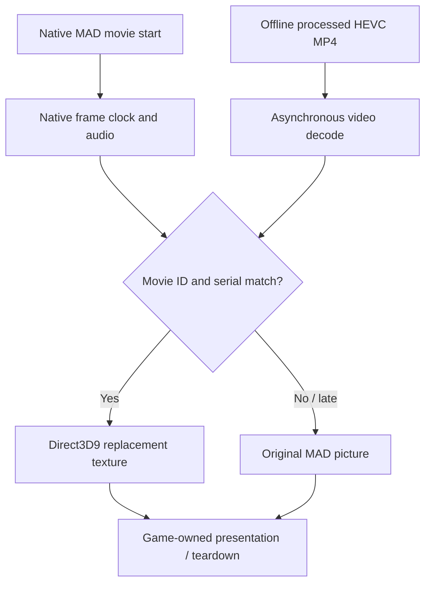

# Architecture

[← FMVPatch overview](../README.md) · [MP4 playback](MP4_PLAYBACK.md) · [Validation](VALIDATION.md)

## One movie lifecycle, two possible picture sources

FMVPatch is a **picture-substitution layer integrated into FMVFix**. It takes previously prepared HEVC MP4 frames and offers them to the game's movie renderer when they match the **native MAD movie identity and frame serial**. All movie scheduling remains owned by Underground.

## Authority and ownership

| Concern | Authoritative layer |
| :--- | :--- |
| Which movie is playing | Native MAD request/session. |
| Frame numbering and playback time | Native movie clock and serial progression. |
| Soundtrack, skipping and teardown | Original Underground FMV subsystem. |
| Replacement picture content | Prepared MP4 decoder and verified serial matching. |
| GPU presentation | Existing Direct3D9 movie rendering path. |
| Absence of replacement picture | **Native MAD picture fallback**. |

The MP4 path is not a second standalone video player, does not control progression, and does not run AI inference during gameplay.

## Source and render geometry

The runtime must respect the **HEVC display aperture**, not assume every coded pixel belongs to the intended picture. The notebook distinguishes a `2176 × 1088` coded frame from a `2160 × 1080` visible output in a validated example. Cropping/framing requirements may also depend on the tested Widescreen Fix configuration, particularly the intro movie `NA_BOOT`.

## Startup prewarming

A fixed-order predictor attempts to decode startup frames for the movie expected next. If ReplayMovies selects another title, the cached frames are **not** applied to the wrong movie. The decoder starts for the actual title; until a matching frame is ready, presentation falls back to MAD. See [Prewarm optimization](PREWARM_OPTIMIZATION.md).

## Engineering status

Stage 2.5.3 demonstrates **20 reported 1080p movies** and **15 reported 4K movies**, with zero logged decoder or texture upload/binding errors in those reports. A later production-oriented edit modified routine logging and error reporting without claiming a new runtime pass in that source-audit environment. FMVPatch is not a separately distributed third `.asi`.
