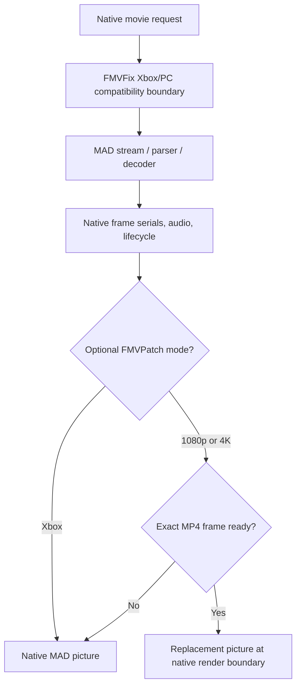

# Architecture

[← FMVFix overview](../README.md) · [Native lifecycle](NATIVE_LIFECYCLE.md) · [Validation](VALIDATION.md)

## Purpose and boundary

FMVFix adapts **Xbox-origin `.mad` movie content** to Underground's existing **PC-native cinematic engine**. It is a compatibility integration, **not** a standalone FMV player and not a replacement for the game's soundtrack, movie clock, frontend return or skip handlers.

The investigation deliberately isolated **movie admission, stream parsing, decode, and presentation**. An Xbox movie reaching a black-screen playback state did not prove that its file was rejected; these are distinct stages that require separate evidence.

## Two independently understandable layers

| Layer | Scope | Preserved behavior |
| :--- | :--- | :--- |
| Xbox `.mad` compatibility | Platform-specific movie parser/decoder admission and surrounding native assumptions. | Native start, timing, audio, teardown and skip. |
| Integrated high-resolution substitution | Optional HEVC/MP4 decoding and Direct3D9 picture replacement. | Same native clock and fallback; no live AI upscale. |

The final record preserves **six frozen Xbox-to-PC compatibility functions** while MP4 presentation logic was developed and production diagnostics were adjusted. Keeping this boundary stable prevents a picture-quality experiment from silently changing Xbox parser behavior.

## Operation modes

`FMVFix.ini` describes `Mode=Xbox`, `Mode=1080p` or `Mode=4K`. Xbox mode disables MP4 substitution. The two other modes optionally substitute a **matching** prepared MP4 picture, with native `.mad` image fallback if that selected tier cannot supply a usable serial.

The private runtime INI and implementation source remain unpublished. Details of the picture side are maintained under [FMVPatch](https://github.com/Gxbbykko/Underground_ReplayMovies_FMVPatch/tree/FMVPatch), **not** a separate third compiled plugin.

## Tested baseline and caveats

The supported reverse-engineering baseline is **English PC v1.4 32-bit**. The supplied handoff identifies a later archived Windows/x86 build, but the current documentation work performed no compilation or gameplay execution. See [Validation](VALIDATION.md) for the precise evidence types.
