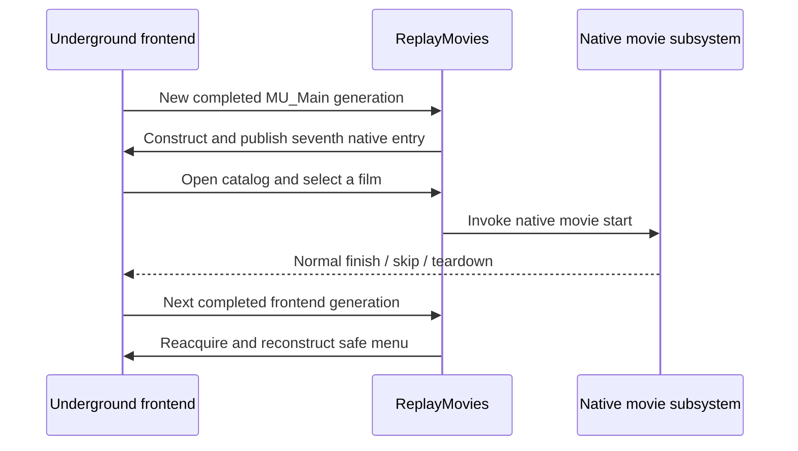

# Lifecycle and hooks

[← ReplayMovies overview](../README.md) · [Architecture](ARCHITECTURE.md) · [Validation](VALIDATION.md)

## Why generation boundaries matter

Underground creates, destroys and recreates its frontend packages as the player enters Options, returns from an FMV, changes profile or exits a race. A stale candidate or `FEObject` pointer can look valid after heap reuse while actually referring to a different generation. ReplayMovies therefore qualifies **completed** `MU_Main` generations and reacquires all runtime relationships within that generation.

## Construction and fallbacks

The original Main Menu candidate vector is **native-owned**. Publishing plugin-static storage as native-owned state caused an early teardown failure and was discarded. The final implementation uses game-owned expanded allocation with the new slot kept at a safe native fallback until the ReplayMovies objects, caption, descriptors and routing are qualified.

A valid menu generation may arrive through the ordinary reconstruction observer or an alternate **Race → Quit Game** path. A later guarded fallback observer covers that alternate path without repeatedly rebuilding an already completed generation.

## Native movie start and return

Movie activation uses the game's FMV pathway. The ReplayMovies menu does **not** replace the native decoder or manually stand in for movie stop, skip, soundtrack or teardown. It records the selected **canonical** film so the right content is requested, and normal native completion/skip returns control to frontend lifecycle handling.

Progression is gated by origin: ordinary eligible career playback may commit a seen bit at termination; manually reviewing a movie via ReplayMovies must not falsely unlock a film.

## Previously resolved lifetime faults

1. **Candidate ownership:** native cleanup cannot free plugin-static memory; corrected by native ownership.
2. **Presentation pairing:** a presumed universal `+0x118` descriptor offset was disproved; corrected by semantic owner traversal.
3. **Movie return:** freshly recreated menus must be observed and reconstructed; fixed for the recorded `01_DAY` and alternate race-exit paths.
4. **Catalog scaffolding:** empty User menus must not inherit the game's stock Trailers/NASCAR row.

The descriptor ownership correction passed **15/15** fresh-generation stress checks. This is a focused regression result, not a claim of exhaustive compatibility.

## Scope and privacy

This public page deliberately explains the lifecycle contract without copying unpublished source files, function patch bodies or private debugger traces.
