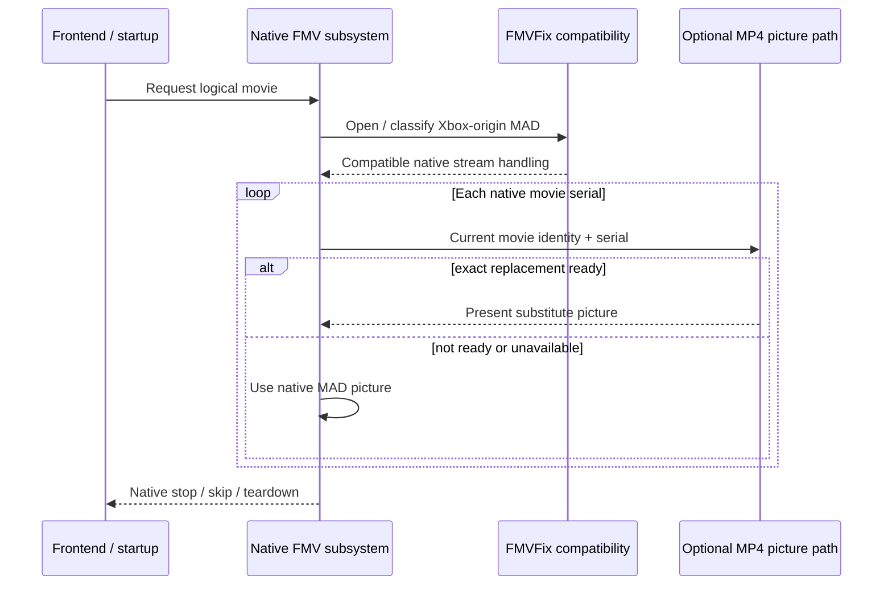

# Native movie lifecycle

[← FMVFix overview](../README.md) · [Architecture](ARCHITECTURE.md) · [Parser and decoder](PARSER_AND_DECODER.md)

## Why native ownership is preserved

FMVFix is deliberately anchored in Underground's existing movie lifecycle. A normal menu or startup movie request creates a native movie session, moves through buffered stream and decode work, presents frames, and restores game/frontend state on **natural end or skip**. Xbox compatibility and optional picture substitution should fit *inside* this sequence.

## Timeline authority

The `.mad` path owns timing, movie-frame serials, audio and the end/skip event. An MP4 **does not** become a second independent timing authority. That design avoids picture/subtitle/music drift caused by running a separately timed external player against the game.

## Different image inspection boundaries

The later engineering record establishes a native clock for intro-class movies and a **post-upload CPU movie-texture** checkpoint for career movies. Both were investigated to produce a stable one-to-one movie-serial/picture relationship. This supports the picture substitution system but does not mean every movie shares identical low-level hook placement.

## Failure handling

If optional MP4 frames are absent, late or invalid, the runtime uses the original MAD picture where applicable. Expected catch-up and out-of-order prewarm misses do not imply an FMV teardown failure. Genuine input/decoder/hook/render faults are separately categorized in the final production-oriented source.

## Relationship to ReplayMovies

[ReplayMovies](https://github.com/Gxbbykko/Underground_ReplayMovies_FMVPatch/tree/ReplayMovies) is a native frontend **invocation surface**. It requests movies through this lifecycle; FMVFix remains responsible for the independent Xbox-to-PC movie compatibility path.
