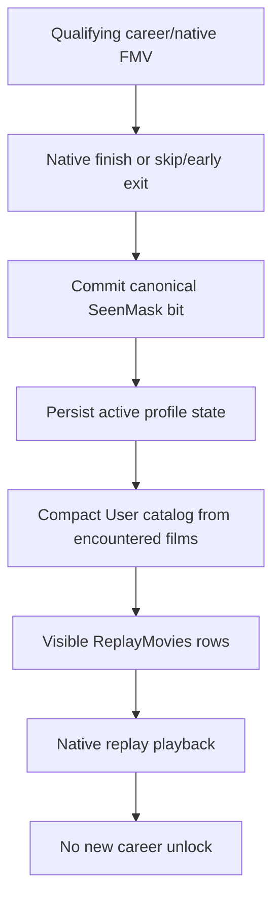

# Profile progression

[← ReplayMovies overview](../README.md) · [Movie catalog](MOVIE_CATALOG.md) · [Validation](VALIDATION.md)

## User and Developer access

| Mode | Visible movies | Progress writes |
| :--- | :--- | :--- |
| **User** | Only career films already encountered by the **active profile**. | Qualifying **career** FMV termination may record an encounter. |
| **Developer** | Full valid 17-entry catalog for engineering inspection. | Selecting a replay does **not** generate career unlocks. |

Mode selection is configured privately rather than added as another in-game menu layer. The published documentation does not include the actual INI, player profiles or source-level storage hooks.

## The persistent seen state

The final implementation associates a canonical film's bit with the active profile's `SeenMask`, persisted in a local `ReplayMoviesProgress.ini`. This file is **per-player runtime state**, not a public configuration template. The canonical mask is projected into a compact User catalog whenever the relevant frontend generation is built.

Keeping canonical IDs separate from physical frontend rows prevents the wrong film being launched when the user has seen only scattered career entries. Each visible row resolves back to the correct canonical film, and returning from playback rebuilds the projection without inventing extra progress.

## Commit semantics

- A normal eligible career movie can set its seen bit on **natural completion**.
- An eligible **skip or early termination** can also commit the encountered movie.
- A movie played **from ReplayMovies** is intentionally excluded from progression commits.
- Progress is **profile-specific**: viewing a movie under one profile must not unlock it for another.

The final notebook explicitly verified `01_DAY` and `02_FAN_S` entering the User catalog only after their respective career encounters, and verified state persistence on natural and skipped endings.

## Empty and one-row catalogs

| State | Expected result |
| :--- | :--- |
| New profile (`SeenMask = 0`) | Empty catalog; no placeholder movie. |
| One encountered movie | A single valid selectable row; safe Up/Down/Back. |
| Several nonconsecutive movies | Dense visible rows in canonical order, with stable movie identity. |
| Full seen mask | User catalog displays all valid canonical entries. |

The native Trailers/NASCAR item is **not** part of this catalog. An earlier contamination bug was later traced and closed; it must not be described as an ongoing defect.

## Evidence limits

The behavior above is recorded as complete for the English PC v1.4 x86 test baseline. No new profile or gameplay test was run for this editorial revision. See the [validation matrix](VALIDATION.md) for recorded cases.
