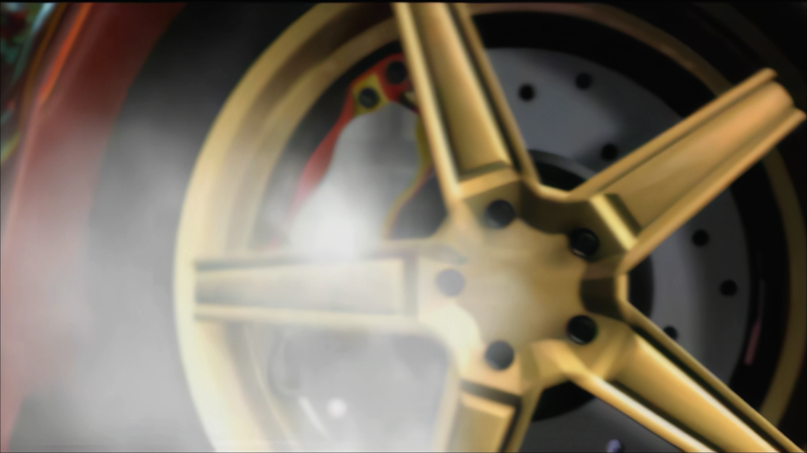
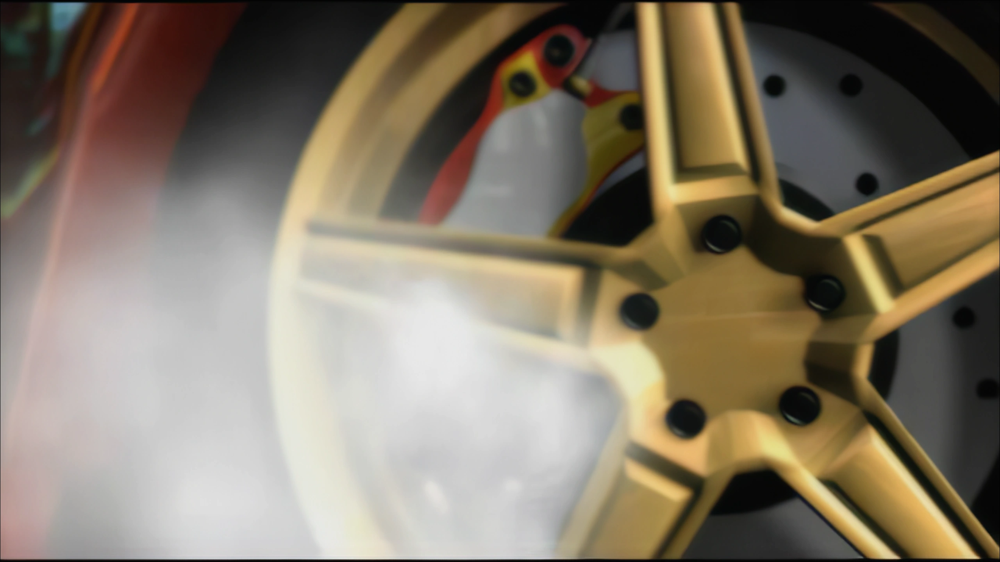

# Renderer integration

[← FMVPatch overview](../README.md) · [Architecture](ARCHITECTURE.md) · [Frame synchronization](FRAME_SYNCHRONIZATION.md)

## Presentation examples

| Prepared 1080p picture tier | Prepared 4K picture tier |
| :---: | :---: |
|  |  |

Both examples are 2560 × 1440 **desktop captures** of a movie picture presented by the game. The mode labels reflect the selected video tier. Visual examples do not substitute for the logged Direct3D9 upload and serial-match evidence.

## Picture replacement, not renderer replacement

The project keeps Underground's existing **Direct3D9 movie presentation path**. The FMVFix-integrated MP4 layer supplies an alternate decoded image only at a vetted movie draw boundary. Native movie session ownership, soundtrack, frame clock and teardown remain intact.

## Presentation contract

| Boundary | Requirement |
| :--- | :--- |
| Movie identity | Replacement belongs to the currently active native FMV. |
| Serial identity | Replacement decoded frame corresponds exactly to the native movie serial. |
| Texture availability | Decoded picture can be uploaded/bound using a valid resource. |
| Geometry | Visible HEVC display aperture and tested presentation crop are respected. |
| Error handling | Bad or late MP4 picture never requires terminating the native movie. |

The Stage 2.5.3 reports record **zero texture upload/binding failures** for the 1080p and 4K measured sessions. That is an observed test result, not a general guarantee about all Direct3D9 devices or wrappers.

## HEVC coded frame versus visible frame

The notebook explicitly resolved a visible-display-aperture issue where HEVC storage included padded coded dimensions. A validated example had **2176 × 1088 coded pixels** but **2160 × 1080 visible pixels**. Upload logic must operate with correct visible crop metadata; otherwise a technically decoded MP4 can still be framed incorrectly.

## Intro movie framing and third-party context

A specific `NA_BOOT` presentation adaptation assumes the tested **ThirteenAG Widescreen Fix cropped-mode** geometry. This is a scoped compatibility observation, not a claim that every version or configuration of the external fix is universally required or supported.

## Failure behavior

When a picture is unavailable, late or invalid, **native MAD drawing** remains the fallback. The quiet-production source reports genuine rendering/decoder failures by category while treating expected catch-up misses as normal. The publicly available evidence does not include a new runtime render test performed during documentation authoring.
