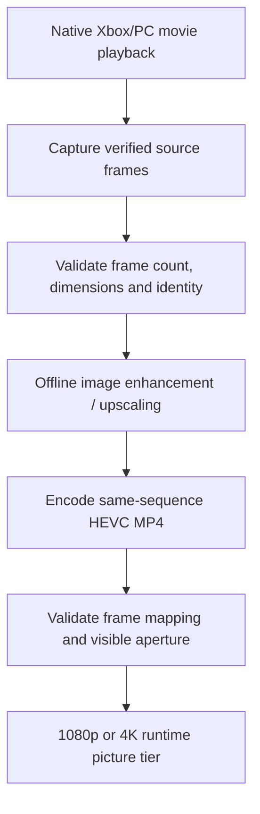

# Offline upscaling pipeline

[← FMVPatch overview](../README.md) · [MP4 playback](MP4_PLAYBACK.md) · [Frame synchronization](FRAME_SYNCHRONIZATION.md)

## What "AI-upscaled" means here

**AI processing happens before gameplay.** Developers prepared higher-resolution movie images using an offline workflow, then supplied encoded HEVC MP4 alternatives to the optional FMVFix picture path. No model runs in the game's address space, and runtime mode selection **does not upscale frames live**.

## Documented source-preparation process

The engineering record describes `.sourcepack` capture artifacts, promoted only after checks of geometry, frame count and file integrity. Intro-class captures and career captures used **different proven observation boundaries**: intro movies at the native clock and career movies at the post-upload CPU movie-texture point. The source movies' native movie serials remain the reference for later substitutions.

## Representative validated capture contracts

| Movie | Recorded native source frames | CPU picture geometry |
| :--- | ---: | :--- |
| `NA_BOOT` | 390 | 512 × 256 |
| `PSA` | 544 | 512 × 256 |
| `E3_TITLE` | 2,426 | 512 × 512 |
| `01_DAY` | 536 | 512 × 256 |

These are **specific recorded capture contracts**, not a universal resolution claim for every cinema/console asset. The other career clips were separately enumerated and checked in the developer's capture pipeline.

## Keep the same frame identity

The offline result must align its frames with the native movie timeline. Frame interpolation, reordering or a different frame count can break the exact native-serial lookup even if the MP4 appears to play correctly as a standalone video. Validation therefore considers identity, frame accounting and correct visible-crop geometry, not merely file existence.

## Rights and distribution

Original `.mad` files, raw captures, `.sourcepack`/`.srpack` files and AI-upscaled HEVC MP4s are **not** included in the public GitHub package. This page describes a private research pipeline, not authorization to redistribute copyrighted game cinematics.
