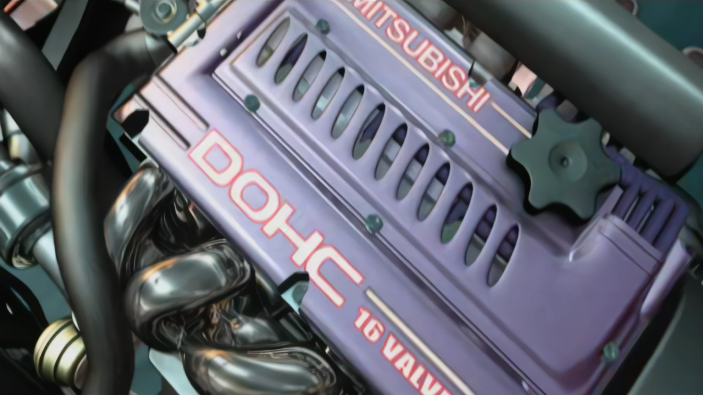
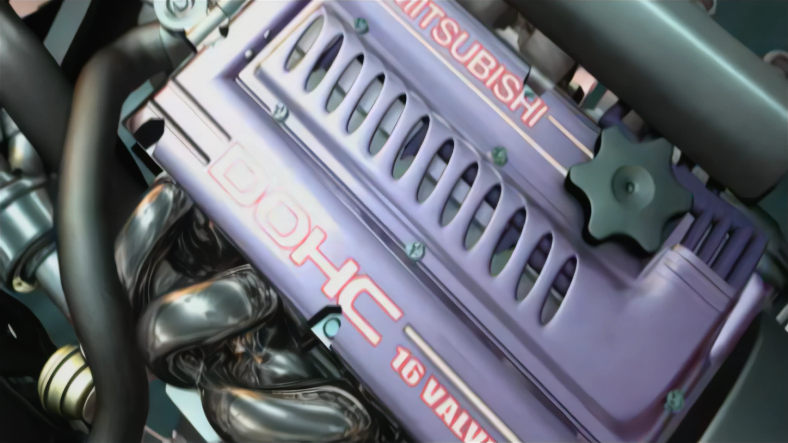

# Validation

[← FMVPatch overview](../README.md) · [Performance](PERFORMANCE.md) · [Known limitations](KNOWN_LIMITATIONS.md)

## Visual demonstration versus measured validation

| 1080p-mode `E3_TITLE` | 4K-mode `E3_TITLE` |
| :---: | :---: |
|  |  |

These stills illustrate output from the respective user-labeled playback modes, but do **not** prove per-frame synchronization, error-free decoding, or native fallback behavior. The measurements below come from the recorded Stage 2.5.3 sessions. Browse all five subjects in the [video-mode gallery](VIDEO_MODES.md#screenshot-gallery--xbox--1080p--4k).

## Consolidated Stage 2.5.3 results

The last consolidated runtime report includes **20 1080p films** and **15 4K films**. It compares the **native MAD movie serials** observed by the game with the exact **MP4 picture serials** that reached the chosen presentation boundary.

| Measurement | 1080p | 4K |
| :--- | ---: | ---: |
| Movie runs represented | **20** | **15** |
| Native MAD serials | **9,931** | **5,610** |
| Exact replacement serials | **9,922** | **5,583** |
| Distinct initial serials without replacement | **9** | **27** |
| Full movie runs with zero fallback | **11** | **6** |
| Decoder failures | **0** | **0** |
| Texture upload/binding failures | **0** | **0** |

The 20-title catalog combines three intro films and 17 career films. **The available 4K report covers 15 titles only**, not a complete 20/20 4K run.

## Nine out-of-order selections

The fixed catalog predictor warmed the *expected* next movie, but the operator chose a different ReplayMovies entry. Cached frames for another movie were rightly rejected. The actual movie's MP4 decoder then caught up asynchronously, while the native `.mad` supplied the initial picture.

| Affected set | Native fallback at start | Subsequent behavior |
| :--- | :--- | :--- |
| Nine 1080p runs | Frame serial **0** | Correct MP4 frames subsequently substituted. |
| Nine 4K runs | Frame serials **0–2** | Correct MP4 frames subsequently substituted. |

Affected IDs: `11_PNK`, `13_KIT`, `12_BUD`, `09_GBE`, `14_MUT`, `16_RES`, `15_DIK`, `08_EDD`, `17_MET`.

> [!IMPORTANT]
> Unique missing **serials** are not identical to failed **draw attempts**. One native serial may be drawn more than once, so a draw-level fallback counter may be larger. The table above deliberately reports distinct missing serials.

## Visual geometry evidence

Earlier 1080p work exposed an HEVC-coded-frame versus visible-display-aperture mismatch. The later validated aperture handling accepts a **2176 × 1088 coded / 2160 × 1080 visible** example. The nine startup misses were **not** a recurrence of this geometry issue: their MP4 format-validation checks passed.

## Subsequent production-source status

A later quiet-production source configuration disabled routine reports and introduced deduplicated diagnostics for genuine MP4/decoder/texture/hook errors. The notebook's source audit did **not** include a new MSVC compile in that environment; a **separate later archive** contained an actual Win32 build log and binary. Neither should be presented as a fresh full-catalog production gameplay retest.

## Claims explicitly excluded

- Zero-fallback startup for **arbitrary** ReplayMovies selections.
- 20/20 movie coverage at **4K** based on these 15 reports.
- Universal GPU/HEVC hardware support or FPS guarantees.
- A standalone FMVPatch `.asi` or in-game AI model.

The documentation is an analysis of retained engineering evidence; **no new movie runs were executed** to prepare this page.
