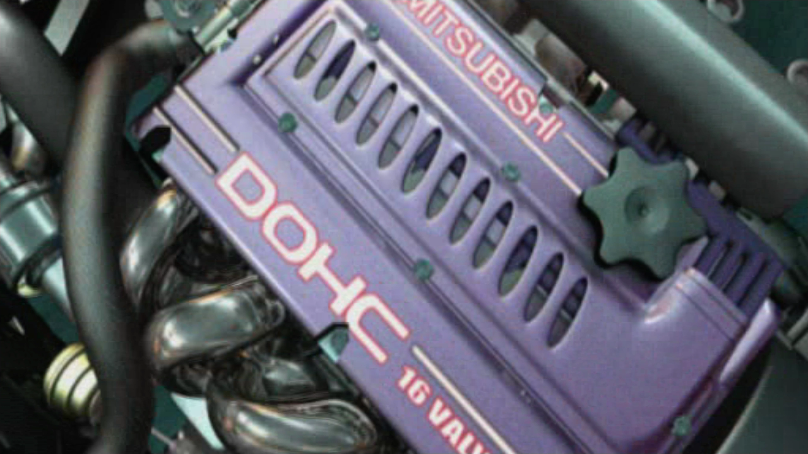

# Validation

[← FMVFix overview](../README.md) · [Compatibility fixes](COMPATIBILITY_FIXES.md) · [Engineering history](ENGINEERING_HISTORY.md)

## Screenshot evidence and limits

A screenshot can demonstrate visible in-game presentation at the instant captured. It cannot on its own establish correct audio, all-frame decode, resource ownership, or teardown. Those validation claims remain grounded in the reported debugger and runtime tests described below. Additional [Xbox-mode captures](XBOX_VS_PC.md#xbox-mode-screenshot-gallery) are available.

## Distinct evidence types

The evidence for Xbox compatibility and high-resolution picture substitution must **not** be conflated.

| Evidence | Supported conclusion | Qualification |
| :--- | :--- | :--- |
| Matched PC/Xbox movie debugger comparisons | Platform divergence boundaries identified across admission, parsing, decode and presentation. | Not an all-executable/all-asset certification. |
| Completed compatibility implementation | Final project handoff treats Xbox `.mad` support as implemented. | Applies to documented English PC v1.4 x86 engineering baseline. |
| Six frozen-function source comparison | Xbox-to-PC core preserved through later optional MP4 changes. | A structural/source check, not itself a new live Windows test. |
| Stage 2.5.3 combined playback reports | MP4 picture reached native presentation with exact movie serials. | Tests picture-substitution behavior, **not** parser admission counts. |
| Supplied archived release build/log | A later Windows/x86 FMVFix binary and successful build log existed in the 2026-10-09 handoff. | This editorial pass did not compile or execute it. |

## Measured integrated sessions

| Stage 2.5.3 measurement | 1080p | 4K |
| :--- | ---: | ---: |
| Movies represented | 20 | 15 |
| Native MAD serials | 9,931 | 5,610 |
| Exact MP4 substitutions | 9,922 | 5,583 |
| First serials not substituted | 9 | 27 |
| Decoder failures | 0 | 0 |
| Texture upload/binding failures | 0 | 0 |

These are **FMVPatch** picture measurements over the integrated native compatibility framework. See the [FMVPatch validation page](https://github.com/Gxbbykko/Underground_ReplayMovies_FMVPatch/blob/FMVPatch/docs/VALIDATION.md) for the exact frame and prewarm interpretation.

## Source audit versus later build evidence

The notebook's quiet-production source handoff explicitly notes that a native MSVC compile was unavailable **in that environment**. A subsequent user-supplied project archive separately contains a **successful Windows Release build log and valid 32-bit `FMVFix.asi`**. Those facts are compatible: they refer to different checkpoints. Neither establishes an additional clean build or playback run performed during this documentation editing pass.

## Compatibility limits

Only the **English PC v1.4 x86** baseline is documented as supported. No public claim is made for other game executables, languages, graphics wrappers, plugin stacks or performance on arbitrary hardware. The recorded specific `NA_BOOT` framing correction should be checked in the tested Widescreen Fix cropped-mode geometry rather than generalized to other modes.
