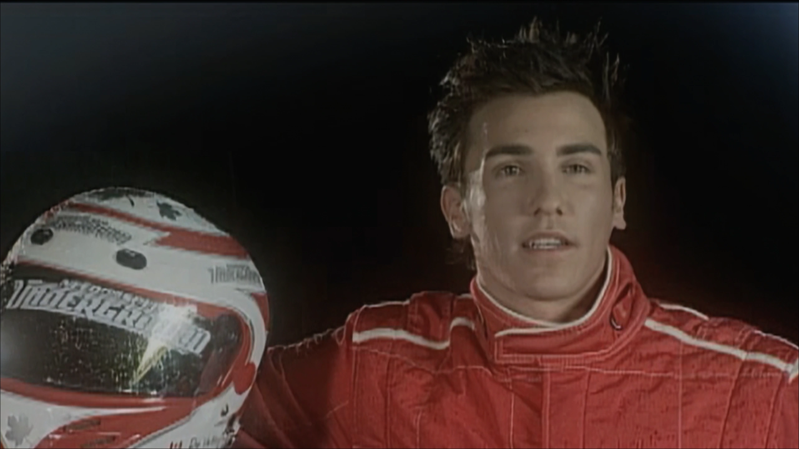
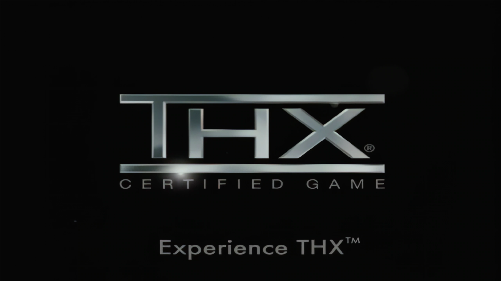
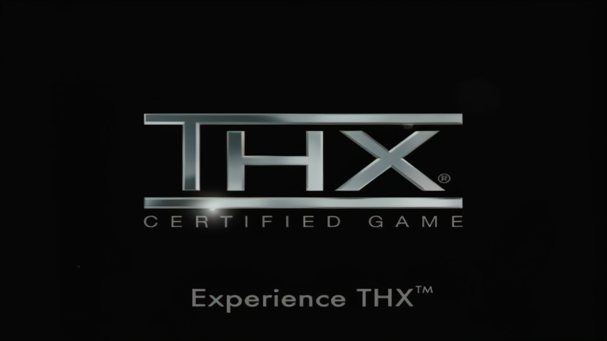

# Video modes

[← FMVPatch overview](../README.md) · [Architecture](ARCHITECTURE.md) · [Known limitations](KNOWN_LIMITATIONS.md)

The integrated **FMVFix** runtime recognizes three documented values of the private `[FMVFix] Mode` setting. These are runtime *picture policies*, not separate standalone ASI plugins.

| Mode | Optional MP4 picture | Clock / audio / skip | If the selected tier cannot supply an exact frame |
| :--- | :--- | :--- | :--- |
| `Xbox` | **Disabled** | Native MAD | Native MAD picture; no MP4 substitution. |
| `1080p` | Prepared **1080p** HEVC MP4 | Native MAD | Native MAD picture for that missing/late serial. |
| `4K` | Prepared **4K** HEVC MP4 | Native MAD | Native MAD picture for that missing/late serial. |

## Screenshot gallery — Xbox / 1080p / 4K

The following screenshots are user-provided captures of the same **movie IDs** in each documented mode. They are supplied at a common **2560 × 1440 screen-capture resolution**; `1080p` and `4K` describe the selected playback source, *not* the saved still-image size. These are not necessarily identical frame-serial captures, so do not interpret pixel differences as a formal resolution benchmark.

### `E3_TITLE` — Engine detail

| Xbox mode | 1080p mode | 4K mode |
| :---: | :---: | :---: |
|  |  |  |

### `01_DAY` — Wheel detail

| Xbox mode | 1080p mode | 4K mode |
| :---: | :---: | :---: |
|  |  |  |

<strong>View the three additional movie comparisons (PSA, NA_BOOT1, NA_BOOT2)</strong>

#### `PSA` — Driver introduction

| Xbox mode | 1080p mode | 4K mode |
| :---: | :---: | :---: |
|  |  |  |

#### `NA_BOOT1` — EA Games opening

| Xbox mode | 1080p mode | 4K mode |
| :---: | :---: | :---: |
|  |  |  |

#### `NA_BOOT2` — THX opening

| Xbox mode | 1080p mode | 4K mode |
| :---: | :---: | :---: |
|  |  |  |

> [!NOTE]
> Screenshots document appearance only. Native-clock synchronization, fallback counts, decode and D3D9 error figures are established in the [runtime validation reports](VALIDATION.md), not through visual inspection of these stills.

## What selecting a mode does not do

- It does **not** perform AI upscaling or encode video in real time.
- It does **not** switch to an independently scheduled MP4 player.
- It does **not** replace original `.mad` audio, game clock or FMV teardown.
- It does **not** guarantee the next movie's startup frames have been decoded, especially with arbitrary ReplayMovies selection order.
- It does **not** prove a fallback from **4K to 1080p**; the documented safe fallback is the **native MAD picture**. Do not claim undocumented automatic cross-tier behavior.

## Default and private configuration

The reviewed source archive documented `Mode=1080p` in its release-oriented INI and `Xbox` as a source fallback if no valid mode was read. This distinction should be checked for the exact version users ultimately install; the real configuration file is **not published here**.

## Choosing a tier

Higher-resolution MP4 decoding has different asset, codec and GPU requirements than native MAD picture playback. This repository does not provide a benchmark covering arbitrary hardware or graphics wrappers. The 4K report contains **15 movie runs**, so selecting 4K must not be described as a completed 20-film 4K compatibility certification.

Consult [Performance](PERFORMANCE.md) for the observed measurements and [Validation](VALIDATION.md) for the movie-set distinction.
